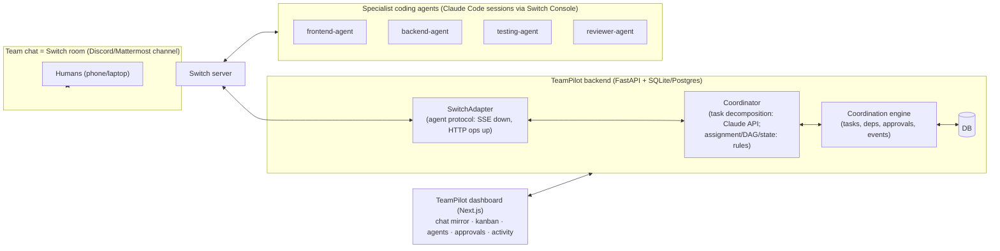

# TeamPilot AI — Architecture

Written 2026-10-31 (pre-hackathon). Hackathon rule: pre-existing app code may be
brought, but **the Switch setup (server, agents, room) and the live agent
workflow are created during Nov 4–7**. This repo is built so that the Nov-4
Switch provisioning is a documented 30-minute step (see
[SWITCH_INTEGRATION.md](SWITCH_INTEGRATION.md)).

## 1. The system in one diagram



**Where Switch is used (and where it isn't):**
- The shared team chat **is a Switch room** bridged to a messaging app. We do
  not build a parallel chat system; the dashboard *mirrors* the room.
- The Coordinator is itself a **Switch agent**: TeamPilot's backend registers
  on the Switch server and speaks the documented agent protocol (one SSE
  stream down, HTTP ops up). Every agent-to-agent instruction
  (TASK_ASSIGNED, REVIEW_REQUEST, …) is a real Switch room message.
- The specialist agents are **Claude Code agents run by Switch Console** —
  Switch's own supported way to run coding agents — with role instructions
  from `agents/` (created during the hackathon).
- The coordination *state* (tasks, DAG, approvals) lives in TeamPilot's DB,
  not in chat history — the room is the communication bus, the DB is the
  source of truth.
- **Honest fallback:** with no Switch credentials configured, the backend runs
  in clearly-labeled **local mode** (`delivered_via: "local"`): everything
  works from the dashboard, and the UI shows "Switch: offline". No fake
  "sent via Switch" claims — delivery channel is recorded per message.

## 2. Components

| Component | Stack | Job |
|---|---|---|
| `backend/` | FastAPI, SQLAlchemy 2, Pydantic v2; SQLite by default, Postgres via `DATABASE_URL` | REST API, coordination engine, Switch adapter, SSE stream to the dashboard |
| Coordination engine | pure Python (`app/engine/`) | decomposition → tasks; DAG validation (cycle rejection); state machine with guards; rule-based assignment; blocker handling; message-budget limits |
| LLM use | Anthropic SDK, `claude-opus-5-5`, structured outputs (`messages.parse`) | only for interpreting a request into subtasks; falls back to transparent rules without an API key |
| Switch adapter | `app/switchbridge/` — httpx, documented protocol only | SSE event stream + 2s heartbeat; ops (`post_message`, `send_targeted_message`, `read_context`, `connect_to_room`); reconnect with backoff |
| `frontend/` | Next.js (App Router), TypeScript, Tailwind | dark dashboard: overview, team chat, kanban, agents, approvals, activity; live via SSE |
| Agent roles | `agents/*.md` (hackathon) | instructions for frontend/backend/testing/reviewer Claude Code agents: JSON card protocol, never fabricate results |

## 3. Message cards

Agents and coordinator exchange **cards**: one human-readable line + a fenced
JSON block the backend validates (Pydantic, discriminated by `type`). Types:
`TASK_ASSIGNED, TASK_STARTED, STATUS_UPDATE, INFORMATION_REQUEST, BLOCKER,
HANDOFF, REVIEW_REQUEST, REVIEW_FEEDBACK, TEST_RESULT, TASK_COMPLETED,
HUMAN_APPROVAL_REQUIRED`. Invalid cards are stored as plain chat, never
executed.

## 4. Safety model

- Task state transitions only through the engine's guarded state machine; the
  API cannot skip states (e.g. `completed` requires: deps done, review passed,
  a recorded passing `ExecutionRun` for test tasks, and an approved `Approval`
  when `requires_approval`).
- `TASK_COMPLETED` from an agent moves a task to **in_review** — never to
  completed ("don't trust the agent's word").
- Merge-type tasks always `requires_approval` → human approves in dashboard
  or chat.
- Loop guards: per-task agent-message budget, per-task attempt limit; blocked
  tasks require human action after the limit.
- Agents run under Switch Console `auto_mode` (provider's own review; risky
  actions ask a human in the room). TeamPilot's backend executes no
  agent-supplied shell commands.
- Audit: every state change is a persisted `TaskEvent`; approvals record who
  and why.

## 5. Folder structure

```
backend/app/{config,db,models,schemas,events,main,seed}.py
backend/app/engine/{graph,state,decompose,coordinator}.py
backend/app/switchbridge/{adapter,connector}.py
backend/app/routers/api.py
backend/tests/
frontend/app/{page,chat,tasks,agents,approvals,activity}/…
agents/            # created Nov 4+ (hackathon rule)
docs/
```

## 6. Credentials needed

| Env var | For | Required? |
|---|---|---|
| `ANTHROPIC_API_KEY` | task decomposition LLM | no (rules fallback) |
| `SWITCH_API_ENDPOINT`, `SWITCH_API_TOKEN`, `SWITCH_AGENT_ID`, `SWITCH_ROOM_ID` | the adapter; written by Switch Console to `.switch/agents/<name>.json` on registration | no until Nov 4 (local mode) |
| `DATABASE_URL` | Postgres | no (SQLite default) |
| `TEAMPILOT_API_TOKEN` | protects mutating API routes | optional (dev) |

## 7. Main risks

1. **Switch task API is "present but not ready"** (per its own docs) → we use
   room messages + our own DB, not Switch tasks.
2. **Agents act only when @mentioned** → every assignment is a targeted
   message; the coordinator re-pings on timeout; budget-limited.
3. **Console-run Switch servers are single-owner** → demo runs all agents from
   one machine's Console; documented.
4. **LLM decomposition variance** → structured outputs + schema validation +
   rules fallback; the DAG is validated (cycles rejected) before tasks are
   created.
5. **Demo flakiness** → the end-to-end scenario is scripted in `docs/` and the
   dashboard works in local mode even if Switch misbehaves live.
```
